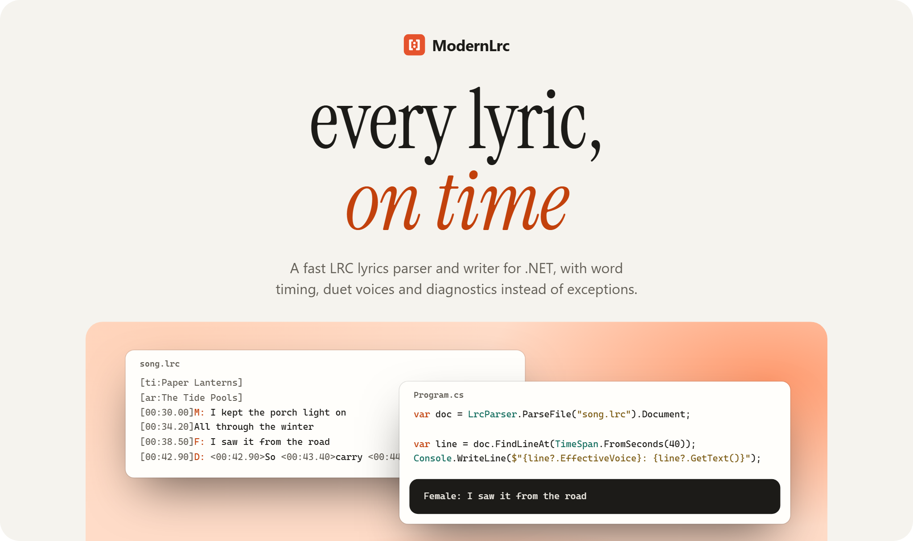
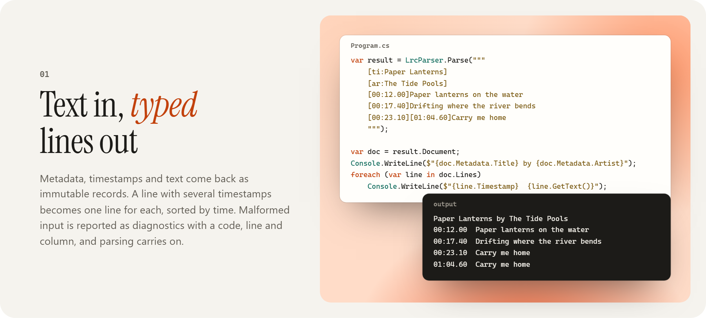
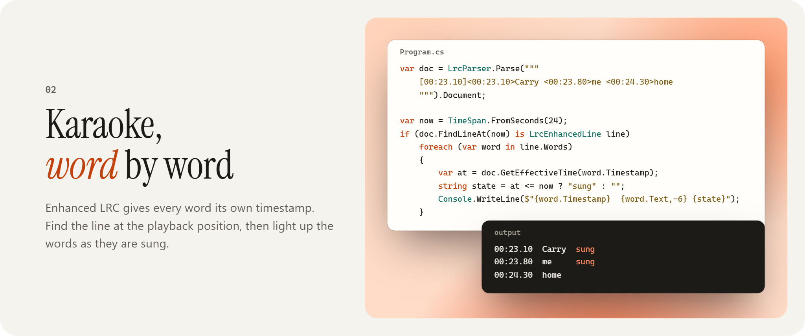
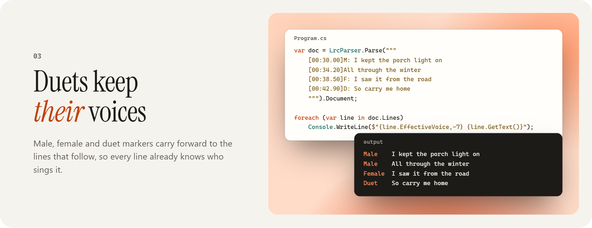
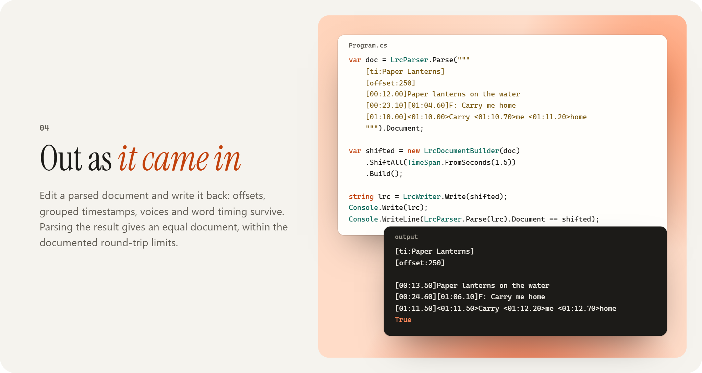

<picture>
  <source media="(prefers-color-scheme: dark)" srcset=".github/readme/hero-dark.png">
  
</picture>

<p align="center">
  <a href="https://www.nuget.org/packages/ModernLrc"><b>Get ModernLrc on NuGet</b></a>
  &nbsp;·&nbsp;
  <a href="https://anthonyy232.github.io/ModernLrcParser/"><b>Documentation</b></a>
  &nbsp;·&nbsp;
  <a href="https://anthonyy232.github.io/ModernLrcParser/api/ModernLrc.html"><b>API reference</b></a>
</p>

ModernLrc is a fast LRC (lyrics) parser and writer for .NET 10 and .NET 11. It reads plain and Enhanced LRC, reports malformed input as diagnostics instead of throwing, looks up the line for a playback position, and writes documents back out. It is Native AOT compatible, trim-safe, and has no dependencies outside the BCL.

The code in the panels below was compiled and run against the library; the output shown is what it printed.

<picture>
  <source media="(prefers-color-scheme: dark)" srcset=".github/readme/feature-parse-dark.png">
  
</picture>

`LrcParser.Parse` returns the document and the diagnostics reported while parsing. It takes a `string`, `ReadOnlySpan<char>`, `ReadOnlyMemory<char>`, `TextReader`, bytes, a `Stream` or a file path, sync and async. Byte input is decoded by BOM, then as UTF-8, then with a fallback you choose (Latin-1 by default).

Malformed input doesn't throw. Each problem gets a stable code (`LRC0001`–`LRC0099`), a severity and a line and column, and parsing carries on:

```csharp
var result = LrcParser.Parse("""
    [00:12]Paper lanterns on the water
    [0x:17.40]Drifting where the river bends
    [00:23.10]Carry me home
    """);

Console.WriteLine($"{result.Document.Lines.Count} lines, errors: {result.HasErrors}");
foreach (var d in result.Diagnostics)
    Console.WriteLine($"{d.Code} {d.Severity} L{d.Line}:C{d.Column} {d.Message}");
```

```text
2 lines, errors: True
LRC0030 Info L1:C1 Non-standard timestamp variant '[00:12]' accepted.
LRC0002 Error L2:C1 '[0x:17.40]' is not a valid timestamp.
LRC0050 Info L2:C11 Free text without timestamp dropped.
```

`LrcStrictness.Strict` throws on the first error instead. Every code is listed in the [diagnostics reference](https://anthonyy232.github.io/ModernLrcParser/articles/diagnostics-reference.html).

<picture>
  <source media="(prefers-color-scheme: dark)" srcset=".github/readme/feature-karaoke-dark.png">
  
</picture>

A line with `<mm:ss.xx>` word timing parses to an `LrcEnhancedLine` with one `LrcWord` per word. `FindLineAt` is a binary search for the line at a playback position, and `LinesInRange` returns the lines coming up. Both apply the file's `[offset:N]`. See [Playback](https://anthonyy232.github.io/ModernLrcParser/articles/playback.html).

<picture>
  <source media="(prefers-color-scheme: dark)" srcset=".github/readme/feature-duet-dark.png">
  
</picture>

Walaoke `M:`, `F:` and `D:` markers apply to their line and every line after it until the next marker. Each line's `EffectiveVoice` is already resolved, so a player can colour lines without tracking state.

<picture>
  <source media="(prefers-color-scheme: dark)" srcset=".github/readme/feature-roundtrip-dark.png">
  
</picture>

Documents are immutable records. Edit one with `LrcDocumentBuilder` or a `with` expression, then write it to a string, `TextWriter`, `Stream`, `IBufferWriter<char>` or `IBufferWriter<byte>`, a fixed span (`TryWrite`), or a file (written atomically).

Writing a document with the default options and parsing it again gives an equal document, keeping the original `[offset:N]` tag. Timestamps are written as `mm:ss.xx` by default, so millisecond timestamps need `TimestampPrecision = LrcTimestampPrecision.Milliseconds` to survive; [Round trips](https://anthonyy232.github.io/ModernLrcParser/articles/getting-started.html#round-trips) lists the other limits. `LrcWriter.ValidateForWrite` reports voice changes that can't be written back.

## Install

```sh
dotnet add package ModernLrc
```

Requires a project targeting .NET 10 or later. The package has builds for `net10.0` and `net11.0`.

## Quick start

```csharp
using ModernLrc;
using ModernLrc.Model;

// Parse
var result = LrcParser.Parse("[ti:Demo]\n[00:01.00]hello\n");
Console.WriteLine(result.Document.Metadata.Title); // Demo

// Author + write
var doc = new LrcDocumentBuilder()
    .WithTitle("My Song")
    .AddLine("00:12.00", "first line")
    .AddLine("00:14.20", "second line", LrcVoice.Female)
    .Build();
string lrc = LrcWriter.Write(doc);
```

[Getting started](https://anthonyy232.github.io/ModernLrcParser/articles/getting-started.html) walks through parsing, editing, writing and async use.

## Supported LRC

| Form | Example | Result |
|---|---|---|
| Basic line | `[00:12.00]text` | One `LrcPlainLine` |
| Multi-timestamp line | `[00:23.10][01:04.60]text` | One line per timestamp, sorted by time; written back as a group |
| Enhanced LRC word timing | `[00:23.10]<00:23.10>Carry <00:23.80>me` | One `LrcEnhancedLine` with a timestamp per word |
| Walaoke voice markers | `[00:30.00]M: text`, `F:`, `D:` | `EffectiveVoice` on that line and the lines after it |
| Metadata tags | `[ti:]` `[ar:]` `[al:]` `[au:]` `[lr:]` `[by:]` `[re:]` / `[tool:]` `[ve:]` `[length:]` `[offset:]` | Typed properties on `LrcMetadata` |
| Other tags | `[foo:bar]` | Kept in `Metadata.RawTags` and written back |
| Non-standard timestamps | `[00:01]` `[00:01.500]` `[1:02:33.45]` `[01:23,45]` | Accepted, with an informational diagnostic |
| ID3 language prefix | `eng\|\|[00:01.00]text` | Prefix removed, with an informational diagnostic |

## Good to know

- Timestamps are kept as written. `[offset:N]` goes to `Metadata.Offset`, and `GetEffectiveTime`, `FindLineAt` and `LinesInRange` apply it. See [Playback](https://anthonyy232.github.io/ModernLrcParser/articles/playback.html).
- Byte input with no BOM that isn't valid UTF-8 is decoded with `FallbackEncoding` (Latin-1 by default) and reported as `LRC0010`. Legacy encodings such as Shift-JIS or GBK aren't detected: set `LrcParseOptions.Encoding`. See [Encoding pipeline](https://anthonyy232.github.io/ModernLrcParser/articles/encoding-pipeline.html).
- Lyric text is kept verbatim, including whitespace-only lines and trailing spaces. Filter them when you display lyrics.
- Common non-standard forms such as `[00:01]`, `[00:01.500]`, `[1:02:33.45]`, `[01:23,45]` and an `eng||` language prefix are accepted with informational diagnostics. See the [diagnostics reference](https://anthonyy232.github.io/ModernLrcParser/articles/diagnostics-reference.html).

## Documentation

- [Getting started](https://anthonyy232.github.io/ModernLrcParser/articles/getting-started.html)
- [Playback](https://anthonyy232.github.io/ModernLrcParser/articles/playback.html)
- [Diagnostics reference](https://anthonyy232.github.io/ModernLrcParser/articles/diagnostics-reference.html)
- [Encoding pipeline](https://anthonyy232.github.io/ModernLrcParser/articles/encoding-pipeline.html)
- [Options reference](https://anthonyy232.github.io/ModernLrcParser/articles/options.html)
- [API reference](https://anthonyy232.github.io/ModernLrcParser/api/ModernLrc.html)

## Comparison

ModernLrc 2.0.1 compared with other .NET LRC libraries on 2026-10-13.

### Performance

Mean time on synthetic basic LRC (Small ≈ 20 lines, Medium ≈ 200, Large ≈ 2,000). Lower is better; the ratio is relative to ModernLrc.

#### Parse

| Library                          | Small (µs)     | Medium (µs)    | Large (µs)       | Large alloc |
|----------------------------------|---------------:|---------------:|-----------------:|------------:|
| **ModernLrc**                    | **0.93 (1.00×)** | **6.51 (1.00×)** | **61.5 (1.00×)**   | **331 KB**  |
| Opportunity.LrcParser 1.0.4      | 1.25 (1.34×) | 9.15 (1.41×) | 130 (2.12×) | 317 KB |
| Kfstorm.LrcParser 1.0.3          | 7.23 (7.75×) | 58.8 (9.03×) | 579 (9.42×) | 2,156 KB |
| LrcParser 2025.623.0 (karaoke-dev) | 13.7 (14.7×) | 132 (20.3×) | 1,398 (22.7×) | 5,434 KB |
| SharpLyrics 1.0.0.2 (archived)   | 109 (117×) | 174 (26.7×) | 848 (13.8×) | 2,252 KB |

#### Write

| Library                          | Small (µs)     | Medium (µs)    | Large (µs)       | Large alloc |
|----------------------------------|---------------:|---------------:|-----------------:|------------:|
| **ModernLrc**                    | **1.99 (1.00×)** | **15.0 (1.00×)** | **181 (1.00×)**    | **197 KB**  |
| Opportunity.LrcParser 1.0.4      | 1.83 (0.96×) | 17.0 (1.15×) | 246 (1.36×) | 648 KB |
| LrcParser 2025.623.0 (karaoke-dev) | 4.31 (2.25×) | 31.1 (2.10×) | 446 (2.46×) | 2,013 KB |
| Kfstorm.LrcParser 1.0.3          | — | — | — | (no write API) |
| SharpLyrics 1.0.0.2 (archived)   | — | — | — | (no write API) |

ModernLrc parses 1.3–2.1× faster than Opportunity.LrcParser, the next fastest, with about 5% more allocation. It writes medium and large inputs 1.15–1.36× faster with about a third of the allocation; Opportunity.LrcParser is slightly faster on small inputs.

### Features

| Capability                              | ModernLrc | Opportunity | karaoke-dev | Kfstorm | SharpLyrics |
|-----------------------------------------|:---------:|:-----------:|:-----------:|:-------:|:-----------:|
| Basic LRC `[mm:ss.xx]text`              |    ✓     |     ✓       |     ✓       |    ✓    |     ✓       |
| Enhanced LRC (word-level `<…>`)         |    ✓     |     ✗       |     ✓       |    ✗    |   partial¹  |
| Walaoke voice markers (`M:`/`F:`/`D:`)  |    ✓     |  partial²   |     ✗       |    ✗    |     ✗       |
| ID3 metadata tags (`ti`, `ar`, `al`, …) |    ✓     |     ✓       |     ✓       |    ✓    |     ✗       |
| `[offset:N]` semantics                  |    ✓     |     ✓       |     ✗       |    ✓    |     ✗       |
| ID3-style language prefix (`eng\|\|…`)  |    ✓     |     ✗       |     ✗       |    ✗    |     ✗       |
| Error recovery (continue past bad input)|    ✓     |  partial³   |     ✗       |    ✗    |     ✗       |
| Structured diagnostics with line/column |    ✓     |     ✗       |     ✗       |    ✗    |     ✗       |
| Strict / lenient parse modes            |    ✓     |     ✗       |     ✗       |    ✗    |     ✗       |
| Round-trip parse → write → parse        |    ✓     |     ✓       |     ✓       |    ✗    |     ✗       |
| Sync write API                          |    ✓     |     ✓       |     ✓       |    ✗    |     ✗       |
| Async parse / write                     |    ✓     |     ✗       |     ✗       |    ✗    |     ✗       |
| Byte / `Stream` input + encoding detect |    ✓     |     ✗       |     ✗       |    ✗    |     ✗       |
| `IBufferWriter<byte/char>` output       |    ✓     |     ✗       |     ✗       |    ✗    |     ✗       |
| `TryParse` / `TryWrite` non-throwing    |    ✓     |     ✗       |     ✗       |    ✗    |     ✗       |
| Native AOT compatible                   |    ✓     |     ✗       |     ✗       |    ✗    |     ✗       |
| Trim-safe                               |    ✓     |     ✗       |     ✗       |    ✗    |     ✗       |
| Target framework                        |  net10.0 | netstandard1.0 | netstandard2.1 | portable PCL | netstandard2.0 |
| Last release on NuGet                   |  2026-11 |  2018-04    |  2025-06    | 2015-06 | 2023-09 (archived) |

¹ SharpLyrics extracts word timing internally, but its public API only returns single-timestamp lines, and only from a file path.
² Opportunity.LrcParser has `LineWithSpeaker` for `Speaker: text`, not Walaoke `M:`/`F:`/`D:` markers carried across lines.
³ Opportunity.LrcParser collects parse exceptions in a list, without codes or severity.

### Methodology

- Inputs are `string` constants of basic LRC with an ID3 header, so no file I/O is timed. SharpLyrics only reads files, so its input is written to a temp file during setup.
- Each library is called through its simplest public entry point, untuned. Write benchmarks start from the library's own parsed model, so only serialization is timed.
- BenchmarkDotNet 0.15.8, .NET 10.0.12, Windows 11, AMD Ryzen 7 9850X3D. Absolute numbers vary by machine; compare the ratios.
- The harness is [`bench/ModernLrc.Benchmarks.Comparison`](bench/ModernLrc.Benchmarks.Comparison); run it with `dotnet run -c Release --project bench/ModernLrc.Benchmarks.Comparison -- --filter "*"`.

## Contributing

Contributions are welcome. Changes are made with coding agents; point yours at [AGENTS.md](AGENTS.md) and open a pull request.

## License

Copyright (c) 2026 Anthony La.

ModernLrc is free software, licensed under the [GNU General Public License v3.0](LICENSE) only, and comes with no warranty. Versions up to 2.0.2 were released under the MIT License and stay available under it.

[Nagi](https://github.com/Anthonyy232/Nagi), a music player for Windows, uses ModernLrc for its synced lyrics.
